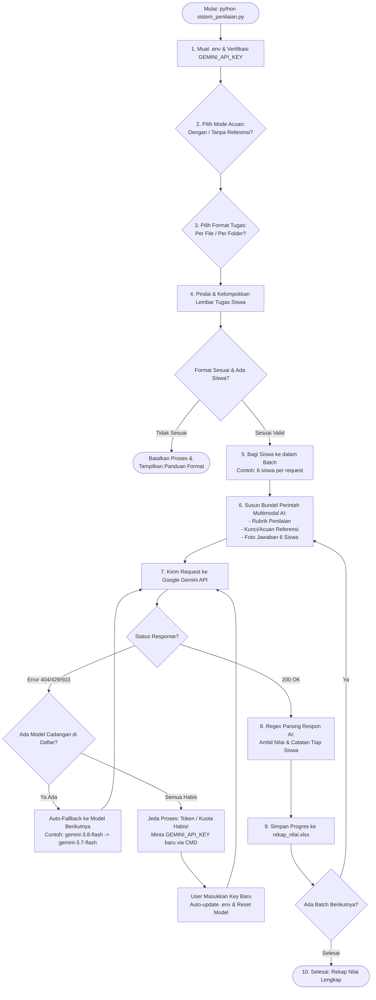

# Sistem Penilaian Tugas Siswa Otomatis Berbasis Gemini AI

**Dibuat & Dikembangkan oleh:** [Rosyi](https://github.com/Rosyiii)

Aplikasi Python berbasis kecerdasan buatan (Google Gemini API) yang berfungsi untuk melakukan penilaian otomatis pada tugas atau lembar jawaban tulisan tangan siswa. Sistem mengevaluasi jawaban siswa berdasarkan materi acuan soal serta rubrik penilaian yang dapat disesuaikan secara fleksibel.

---

## 1. Fitur Utama

- **Pemisahan Konfigurasi Aman (`.env`):** Seluruh kredensial rahasia (`GEMINI_API_KEY`) dan path folder dikelola melalui file environment, menjaga kerahasiaan saat kode dibagikan ke repository.
- **Dua Opsi Format Lembar Jawab Siswa:**
  - **Opsi 1 (Per File):** Semua file diletakkan langsung di dalam folder tugas dengan format nama file `[NAMA]_[keterangan].jpg`.
  - **Opsi 2 (Per Folder Bertingkat):** Menata berkas berjenjang per kelas dan per siswa (`foto_tugas/Kelas/Nama (NIS)/foto.jpg`), memungkinkan koreksi massal untuk banyak kelas sekaligus dalam sekali jalan.
- **Validasi Format & Pembatalan Otomatis (Fail-Safe):** Jika struktur berkas atau folder tidak sesuai dengan opsi yang dipilih, sistem membatalkan proses secara aman tanpa membuat panggilan API sia-sia.
- **Penanganan Otomatis Kuota / Token Habis (Live Recovery):** Jika di tengah pengerjaan token/kuota harian Gemini habis (HTTP 429 / Resource Exhausted), sistem menjeda pengerjaan, meminta input `GEMINI_API_KEY` baru langsung di CMD, otomatis memperbarui file `.env`, dan melanjutkan batch yang tertunda tanpa mengulang siswa yang sudah dikoreksi.
- **Simpan Progres Bertahap:** Setiap kali satu batch selesai dinilai, hasilnya langsung disimpan ke Excel sehingga progres tidak akan hilang jika proses terputus.
- **Pemuatan Rubrik Multi-Format (`prompts/`):** Guru dapat mengubah rubrik/kriteria penilaian tanpa menyentuh kode program. Mendukung format **`.docx`**, **`.txt`**, dan **`.md`**.
- **Materi Acuan Fleksibel (`referensi/`):** Mendukung dokumen soal atau bahan bacaan acuan berbasis teks (**PDF**, **DOCX**, **TXT**, **MD**) serta foto/skema acuan (**JPG**, **PNG**, **WEBP**).
- **Ekspor Otomatis ke Excel:** Menyimpan rekapitulasi nilai, kelas, NIS, jumlah halaman jawaban, dan catatan evaluasi/justifikasi AI ke dalam berkas `rekap_nilai.xlsx`.

---

## 2. Struktur Direktori Proyek

```text
├── foto_tugas/                     # (Input) Foto lembar tugas siswa (.jpg/.png/.webp)
│   # --- Opsi 1: Format Per File ---
│   ├── AHMAD PRATAMA_lembar1.jpg
│   ├── AHMAD PRATAMA_lembar2.jpg
│   └── BUDI SANTOSO_01.jpg
│   # --- ATAU Opsi 2: Format Per Folder ---
│   ├── Kelas 10-A/
│   │   ├── 12345 - Ahmad Pratama/
│   │   │   ├── lembar1.jpg
│   │   │   └── lembar2.jpg
│   │   └── Budi Santoso/
│   │       └── tugas.jpg
│   └── Kelas 10-B/
│       └── Citra Lestari (12346)/
│           └── jawaban.jpg
├── referensi/                      # (Input) Soal/kunci acuan (.pdf/.docx/.txt/.md/.jpg/.png)
├── prompts/                        # (Input) File rubrik penilaian (.docx/.txt/.md)
│   ├── rubrik_dengan_referensi.md  # Rubrik jika bahan acuan tersedia
│   └── rubrik_tanpa_referensi.md   # Rubrik standar pengetahuan umum
├── utils/                          # Modul utilitas sistem
│   ├── __init__.py
│   └── document_reader.py          # Parser dokumen rubrik dan referensi
├── .env                            # Konfigurasi lokal & API Key (Private, jangan di-commit)
├── .env.example                    # Template konfigurasi environment
├── .gitignore                      # Aturan pengecualian berkas Git
├── requirements.txt                # Daftar pustaka Python yang dibutuhkan
├── sistem_penilaian.py             # Skrip utama alur evaluasi
├── ISSUE_TRACKER.md                # Pelacak progres & arsitektur proyek
└── rekap_nilai.xlsx                # (Output) Rekapitulasi hasil penilaian
```

---

## 3. Alur Kerja Sistem & Anatomi Perintah AI

### A. Diagram Alur Kerja Sistem (Workflow Architecture)



---

### B. Gambaran Nyata: Apa yang Dikirimkan Sistem ke Model AI?

Sistem mengirimkan sebuah **bundel multimodal (teks + gambar base64)** ke endpoint `generateContent` Gemini. 

Bayangkan seperti seorang guru penguji yang menerima satu map berkas di atas mejanya dengan susunan yang sangat rapi:

```text
================================================================================
KONTEN PERMINTAAN (PAYLOAD) YANG DITERIMA GOOGLE GEMINI AI
================================================================================

[BAGIAN 1: TEKS INSTRUKSI & RUBRIK PENILAIAN]
Isi berkas dari folder prompts/ (misal: prompts/rubrik_tanpa_referensi.md):
"Anda adalah seorang guru penilai yang teliti, adil, profesional, dan objektif.
TUGAS SISWA: Siswa mengerjakan 10 soal matematika/fisika...
RUBRIK:
- Diketahui (2), Ditanya (2), Dijawab (2) = 6 poin.
- Jawaban benar = 4 poin. Total = 100 poin.
ATURAN OUTPUT: Wajib gunakan format ---SISWA: [Nama]--- NILAI: [0-100] CATATAN: [...]"

--------------------------------------------------------------------------------
[BAGIAN 2: DOKUMEN ACUAN / REFERENSI] (Hanya jika Mode 'Dengan Referensi' aktif)
Header: "========================================
[DOKUMEN ACUAN] BAHAN BACAAN / KUNCI JAWABAN MATERI:
========================================"
- Teks narasi/soal resmi (jika ada PDF/DOCX/TXT di folder referensi/)
- [Gambar Tersemat 1]: Foto Kunci Jawaban / Kisi-kisi (Format Base64 JPEG)
- [Gambar Tersemat 2]: Foto Pembahasan Resmi

--------------------------------------------------------------------------------
[BAGIAN 3: LEMBAR JAWABAN SISWA (BATCH 6 SISWA SEKALIGUS)]
1. Header Siswa 1:
   "LEMBAR JAWABAN SISWA: Chesta (Kelas: Kelas X-1) (2 halaman)
    Gunakan format nama persis pada tag output: ---SISWA: Chesta---"
   - [Gambar Tersemat]: Foto lembar jawaban Chesta Halaman 1
   - [Gambar Tersemat]: Foto lembar jawaban Chesta Halaman 2

2. Header Siswa 2:
   "LEMBAR JAWABAN SISWA: Eva Sintya (Kelas: Kelas X-1) (2 halaman)
    Gunakan format nama persis pada tag output: ---SISWA: Eva Sintya---"
   - [Gambar Tersemat]: Foto lembar jawaban Eva Sintya Halaman 1
   - [Gambar Tersemat]: Foto lembar jawaban Eva Sintya Halaman 2

... (berlanjut hingga Siswa ke-6 dalam batch tersebut)
================================================================================
```

---

### C. Apa yang Dihasilkan AI & Bagaimana Sistem Mengolahnya?

Google Gemini membaca seluruh foto tulisan tangan siswa, membandingkannya dengan rubrik/kunci, lalu memberikan jawaban terstruktur:

```text
---SISWA: Chesta---
NILAI: 86
CATATAN: Nomor 1 sampai 7 ditulis lengkap diketahui, ditanya, dan dijawab dengan hasil perhitungan yang tepat (70 poin). Nomor 8-9 rumus benar namun keliru saat substitusi angka akhir (12 poin). Nomor 10 benar (10 poin).

---SISWA: Eva Sintya---
NILAI: 94
CATATAN: Sistematika penulisan sangat rapi dan konsisten pada 10 soal. Terdapat sedikit kekeliruan perhitungan pada nomor 4.
```

Program Python menggunakan mesin pencocokan regex:
1. `---SISWA:\s*([^-\n]+)` $\rightarrow$ Mengekstrak **Nama Siswa**.
2. `NILAI:\s*(\d+)` $\rightarrow$ Mengekstrak **Nilai Angka**.
3. `CATATAN:\s*(.*)` $\rightarrow$ Mengekstrak **Alasan & Rincian Evaluasi**.

Data ini langsung disusun menjadi tabel *DataFrame* dan diekspor ke **`rekap_nilai.xlsx`**.

---

## 4. Prasyarat Sistem

- **Python:** Versi 3.9 atau yang lebih baru.
- **Google AI Studio API Key:** Dapatkan kunci API gratis di [Google AI Studio](https://aistudio.google.com/app/apikey).

Periksa ketersediaan Python di terminal Anda:
```bash
python --version
```

---

## 5. Langkah Instalasi (Clone via GitHub)

1. **Clone Repository dari GitHub:**
   Buka Terminal / Command Prompt (CMD) / PowerShell, lalu jalankan:
   ```bash
   git clone https://github.com/Rosyiii/PENILAIAN-BERBASIS-AI-GEMINI.git
   ```

2. **Masuk ke Direktori Proyek:**
   ```bash
   cd PENILAIAN-BERBASIS-AI-GEMINI
   ```

3. **(Opsional & Disarankan) Buat dan Aktifkan Virtual Environment:**
   * Di Windows:
     ```bash
     python -m venv .venv
     .venv\Scripts\activate
     ```
   * Di Linux / macOS:
     ```bash
     python3 -m venv .venv
     source .venv/bin/activate
     ```

4. **Instal Seluruh Dependensi:**
   ```bash
   pip install -r requirements.txt
   ```

5. **Konfigurasi Lingkungan (`.env`):**
   Salin berkas template `.env.example` menjadi `.env`:
   * Di Windows (CMD / PowerShell):
     ```bash
     copy .env.example .env
     ```
   * Di Linux / macOS:
     ```bash
     cp .env.example .env
     ```

   Buka berkas `.env` dan masukkan API Key Gemini Anda:
   ```env
   GEMINI_API_KEY=AIzaSy...masukkan_kunci_anda_di_sini
   FOLDER_TUGAS=./foto_tugas
   FOLDER_REFERENSI=./referensi
   FOLDER_PROMPTS=./prompts
   OUTPUT_EXCEL=rekap_nilai.xlsx
   SISWA_PER_BATCH=6
   ```

---

## 6. Panduan Penggunaan

### A. Menyiapkan Bahan Acuan (`referensi/`)
- Masukkan dokumen soal, silabus materi, atau kunci jawaban ke folder `referensi/`.
- Format yang didukung:
  - **Dokumen Teks:** `.pdf`, `.docx`, `.txt`, `.md`
  - **Gambar Acuan:** `.jpg`, `.jpeg`, `.png`, `.webp`
- *Catatan:* Jika folder ini kosong, sistem otomatis beralih menilai berdasarkan pemahaman konsep umum.

### B. Menyesuaikan Rubrik Penilaian (`prompts/`)

Agar tidak bingung merangkai kata-kata prompt, kami telah menyediakan **Trik Praktis 5 Detik (Arsitektur 2-File)**:

1. **File Template Copas Gemini Web (Otomatis & Tanpa Pusing):**
   * [prompts/TEMPLATE_COPAS_GEMINI_WEB_DENGAN_REFERENSI.md](file:///c:/Users/aster/Downloads/Penilaian%20Test/prompts/TEMPLATE_COPAS_GEMINI_WEB_DENGAN_REFERENSI.md) (Jika ada bahan kunci/soal acuan)
   * [prompts/TEMPLATE_COPAS_GEMINI_WEB_TANPA_REFERENSI.md](file:///c:/Users/aster/Downloads/Penilaian%20Test/prompts/TEMPLATE_COPAS_GEMINI_WEB_TANPA_REFERENSI.md) (Jika tanpa bahan acuan terpisah)
   * *Cara Pakai:* Buka template di atas, copy seluruh teksnya, paste ke [Gemini Web (Google)](https://gemini.google.com), upload foto soal/kunci Anda, tekan Enter!

2. **Berkas Running Sistem (Yang Dibaca oleh Program):**
   * [prompts/rubrik_dengan_referensi.md](file:///c:/Users/aster/Downloads/Penilaian%20Test/prompts/rubrik_dengan_referensi.md)
   * [prompts/rubrik_tanpa_referensi.md](file:///c:/Users/aster/Downloads/Penilaian%20Test/prompts/rubrik_tanpa_referensi.md)
   * *Cara Pakai:* Cukup timpa (*paste*) hasil balasan dari Gemini Web tadi ke salah satu file running ini. Begitu selesai, langsung jalankan program!

*Panduan lengkap dan contoh rubrik per mata pelajaran: [prompts/PANDUAN_MENULIS_RUBRIK.md](file:///c:/Users/aster/Downloads/Penilaian%20Test/prompts/PANDUAN_MENULIS_RUBRIK.md).*

#### Aturan Mengubah File Prompt:
1. **Bagian yang BEBAS Diubah / Disesuaikan Guru:**
   * **Deskripsi Tugas Siswa:** Jelaskan apa tugas yang dikerjakan murid (contoh: *10 soal hitungan fisika*, *esai 200 kata*, atau *analisis kasus*).
   * **Peran Berkas di Folder `referensi/`:** Jelaskan kepada AI apa fungsi berkas acuan Anda (*kunci jawaban resmi*, *lembar soal*, atau *materi bacaan*).
   * **Kriteria & Bobot Nilai:** Bebas tentukan pembagian poin (misal: *cara pengerjaan 6 poin, hasil akhir 4 poin, skala total 0-100*).
2. **Bagian yang WAJIB JANGAN DIUBAH (Paling Bawah):**
   * Format teks di bagian paling bawah file prompt **WAJIB dipertahankan apa adanya**:
     ```text
     ---SISWA: [Nama Siswa]---
     NILAI: [Angka 0-100]
     CATATAN: [Evaluasi pemahaman konsep, poin per nomor, dll]
     ```
   * *Alasan:* Format 3 baris ini dibaca otomatis oleh program Python untuk diekspor ke tabel Excel `rekap_nilai.xlsx`. Jika format ini diubah, nilai siswa tidak akan terbaca ke Excel!

### C. Menyiapkan Lembar Jawaban Siswa (`foto_tugas/`)

Pilih salah satu dari 2 opsi format berikut:

#### Opsi 1: Format Per File (Single Folder)
- Masukkan seluruh foto tugas langsung ke dalam folder `foto_tugas/`.
- Gunakan format nama file: `[Nama Siswa]_[Keterangan].jpg` (atau format ekspor LMS Moodle).
  - Contoh:
    - `Ahmad Pratama_halaman1.jpg`
    - `Ahmad Pratama_halaman2.jpg`
    - `Citra Lestari_55858_tugas.jpg`
- Sistem akan otomatis menggabungkan file milik siswa yang sama.

#### Opsi 2: Format Per Folder (Bertingkat per Kelas)
- Cocok jika ingin mengoreksi seluruh siswa sekaligus dari beberapa kelas yang berbeda.
- Susun struktur folder di dalam `foto_tugas/` sebagai berikut:
  ```text
  foto_tugas/
  |-- <Nama Kelas>/
      |-- <Nama Siswa (bisa disertai NIS)>/
          |-- foto1.jpg
          \-- foto2.jpg
  ```
- Contoh format folder siswa yang didukung:
  - `12345 - Ahmad Pratama` *(NIS: 12345, Nama: Ahmad Pratama)*
  - `Citra Lestari (12346)` *(NIS: 12346, Nama: Citra Lestari)*
  - `Budi Santoso` *(Nama: Budi Santoso, tanpa NIS)*

### D. Menjalankan Penilaian

Jalankan skrip utama di terminal/CMD:
```bash
python sistem_penilaian.py
```

**Konfirmasi 1: Mode Referensi Acuan (Menggunakan Referensi atau Tidak)**
Pada tahap pertama, sistem akan menanyakan apakah evaluasi tugas ingin mengacu pada dokumen/foto materi acuan di folder `referensi/` atau murni pemahaman umum AI:
```text
=======================================================
           PILIHAN 1: MODE REFERENSI ACUAN
=======================================================
 [1] Dengan Referensi (Gunakan bahan acuan di folder referensi/)
 [2] Tanpa Referensi  (Pengetahuan umum AI, abaikan folder referensi)
=======================================================
Pilih mode referensi (1/2) [Tekan Enter untuk default: 1]: 
```
* **Pilih `1` (Dengan Referensi):**  
  AI akan membaca seluruh teks (PDF/DOCX/TXT/MD) dan gambar acuan (JPG/PNG) di folder `referensi/`, lalu memuat rubrik [prompts/rubrik_dengan_referensi.md](file:///c:/Users/aster/Downloads/Penilaian%20Test/prompts/rubrik_dengan_referensi.md). AI akan mencocokkan kebenaran jawaban siswa secara ketat berdasarkan kunci/materi acuan tersebut.  
  *(Catatan: Jika folder `referensi/` ternyata kosong, sistem akan memberikan peringatan dan otomatis beralih ke mode pengetahuan umum).*
* **Pilih `2` (Tanpa Referensi):**  
  AI akan mengabaikan seluruh isi folder `referensi/` dan memuat rubrik [prompts/rubrik_tanpa_referensi.md](file:///c:/Users/aster/Downloads/Penilaian%20Test/prompts/rubrik_tanpa_referensi.md). AI menilai berdasarkan pemahaman umum konsep keilmuan tanpa perlu menyiapkan materi acuan terlebih dahulu.
* **Langsung Tekan Enter:** Otomatis memilih mode default (`1 - Dengan Referensi`).

**Konfirmasi 2: Format Lembar Jawab Siswa**
```text
=======================================================
        PILIHAN 2: FORMAT LEMBAR JAWAB SISWA
=======================================================
 [1] Per File   (Semua file di foto_tugas/ berformat NAMA_id.jpg)
 [2] Per Folder (Struktur: foto_tugas/Kelas/Nama/foto.jpg)
=======================================================
Pilih format lembar jawab (1/2) [Tekan Enter untuk default: 1]: 
```

> **Validasi Otomatis:**  
> Jika struktur folder/file tidak sesuai dengan opsi yang Anda pilih, sistem akan langsung membatalkan (cancel) proses dengan menampilkan diagram panduan format yang tepat.

---

## 7. Penanganan Kuota / Token Habis (Live Recovery)

Jika token atau kuota Gemini API habis di tengah-tengah proses pengerjaan (Error HTTP 429 / RESOURCE_EXHAUSTED):
1. **Sistem Menjeda:** Proses otomatis dijeda tanpa kehilangan data/progres siswa yang sudah selesai dinilai.
2. **Permintaan API Key Baru di CMD:** Sistem menampilkan prompt langsung di terminal:
   ```text
   =================================================================
         PERMINTAAN INPUT GEMINI_API_KEY BARU
   =================================================================
   Kuota / Token Gemini API Anda telah habis atau terkena limit.
   Masukkan GEMINI_API_KEY baru untuk melanjutkan proses koreksi.
   
   >> Masukkan GEMINI_API_KEY baru: 
   ```
3. **Pembaruan Otomatis `.env`:** Begitu Anda memasukkan kunci baru, sistem langsung memperbarui variabel `GEMINI_API_KEY` di file `.env` dan sistem memori.
4. **Melanjutkan Pengerjaan:** Sistem secara otomatis melanjutkan penilaian batch yang tertunda hingga selesai.

---

## 8. Format Output (`rekap_nilai.xlsx`)

File Excel yang dihasilkan memuat kolom-kolom berikut:
| Kolom | Keterangan |
| :--- | :--- |
| **Kelas** | Nama kelas siswa (muncul saat menggunakan format per folder) |
| **NIS** | Nomor Induk Siswa jika tercantum pada nama folder/file |
| **Nama Siswa** | Nama lengkap siswa hasil ekstraksi otomatis |
| **Jumlah Halaman** | Total foto lembar tugas yang dikumpulkan siswa |
| **Nilai** | Skor numerik (skala 0 - 100) berdasarkan rubrik |
| **Evaluasi Konsep / Catatan** | Analisis AI: ketepatan materi acuan, estimasi kata, dan justifikasi poin |

---

## 9. Troubleshooting & FAQ

* **`[!] Error: GEMINI_API_KEY belum dikonfigurasi di berkas .env!`**  
  Sistem akan langsung meminta Anda mengetikkan kunci API di terminal saat pertama kali dijalankan dan menyimpannya ke berkas `.env`.
* **`[!] FORMAT TIDAK SESUAI - PROSES DIBATALKAN`**  
  Pastikan berkas foto diletakkan sesuai opsi yang dipilih (file langsung di folder untuk Opsi 1, atau subfolder `Kelas/Nama/` untuk Opsi 2).
* **Teks Tulisan Tangan Tidak Terbaca Optimal**  
  Pastikan foto lembar tugas siswa diambil dengan pencahayaan yang cukup, fokus yang tajam, dan tidak terpotong.

---

## 10. Kredit & Pengembang

* **Pengembang / Author:** **Rosyi** ([@Rosyiii](https://github.com/Rosyiii))
* **Lisensi:** Open-Source Educational Tool
* **Dibuat dengan:** Python 3 & Google Gemini AI API


